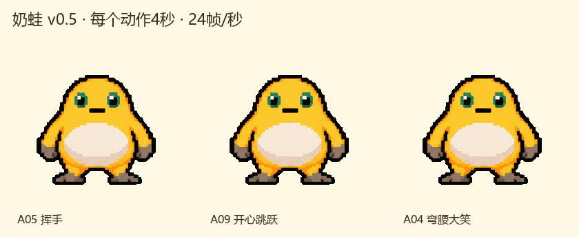
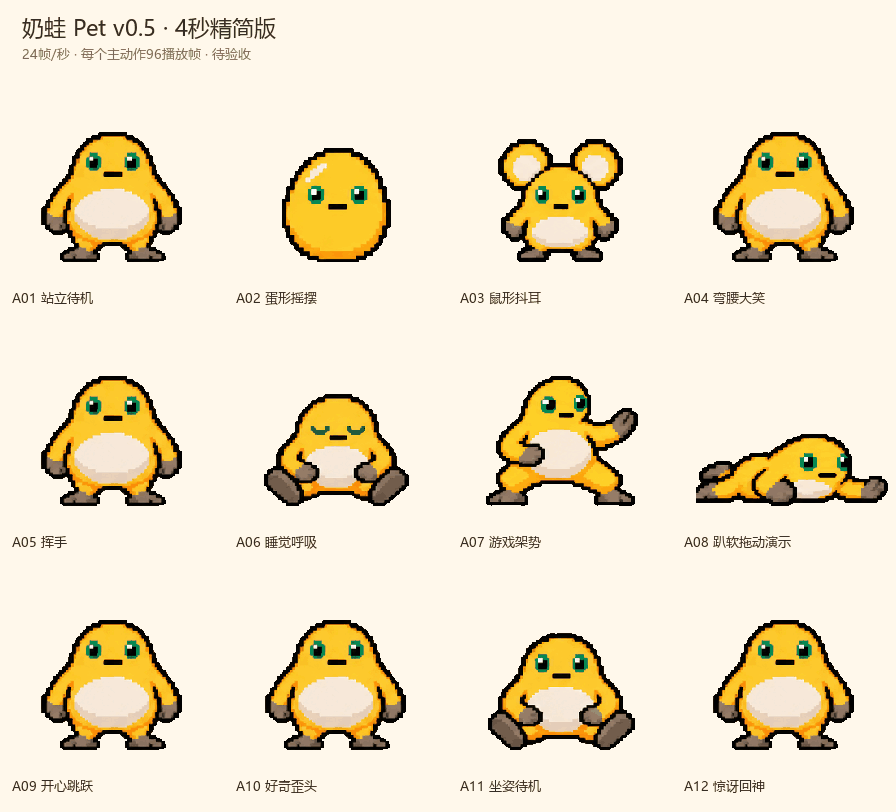

# 8bit奶蛙桌宠 v1.0 使用说明

## 第一次运行

从本仓库 Releases 下载 Windows 压缩包并解压，双击 `奶蛙桌宠.exe`。无需安装、无需管理员权限，也无需 Python 或浏览器。

系统要求：Windows 10 / 11，.NET Framework 4.8。程序使用系统透明窗口和通知区域功能；建议先在 100% 大小下体验。

奶蛙默认出现在主屏幕右下角。它没有背景框，也不会在任务栏增加一个普通窗口；通知区域会出现奶蛙图标。如果图标被折叠，请展开托盘的隐藏图标区域。

## 基本互动

单击头部会挥手，单击身体会轻压回应。双击时，两次点击须相隔不超过 300 毫秒，并落在邻近位置。

连续点肚皮三次可以挠痒。三次须在 1.2 秒内完成。肚皮单击和双击会等这段识别时间结束再判断；三连点优先触发大笑，不会先跳一次再笑。

在奶蛙附近停留约 0.3 秒，它站着时会好奇歪头。坐姿保持坐着，悬停不会把睡着的奶蛙唤醒。

## 移动奶蛙

按住可见的身体并移动鼠标，移动距离超过 6 个屏幕像素后开始拖动。鼠标抓取点保持连续，身体会随运动方向轻微变形。

松手后，拉伸先在约 0.3 秒内消除，再完成当前姿势的收势和回站立路径。奶蛙不会根据甩动速度继续飞行。释放到屏幕边缘之外时，会平滑回到相邻屏幕可显示的区域。

可以从站立、坐姿、睡眠、变形、跳跃或过渡中抓取；恢复过程中也可以再次抓取。拖动会取消等待中的点击和旧互动。

## 待机与睡眠

约 90 秒没有与奶蛙互动，它会坐下；约 5 分钟后睡觉。鼠标在其他应用中的移动、键盘输入和工作内容不会被读取或当作互动。

点击睡着的奶蛙，它先睁眼、坐好，再站起挥手。唤醒过程中的连续点击只用于唤醒，不叠加跳跃或大笑。

在右键菜单取消“自动待机 / 坐下 / 睡觉”，可以停止自动坐下、睡眠和随机彩蛋；手动互动仍可使用。取消自动待机时不会把当前姿势立即切回站立，可用“回到桌面右下角”恢复。

## 小游戏与菜单

在菜单开启“小游戏：点我跳跃”，奶蛙会摆出架势。点击或双击触发成功跳跃，跳完再回到架势。取消小游戏会完成收势后站立；20 秒无游戏互动也会退出。

右键奶蛙，或右键系统托盘图标，可以暂停、切换置顶、改变大小、隐藏、看单个动作、查看说明或退出。双击托盘图标可以重新显示奶蛙，并把它放回当前鼠标所在屏幕的右下角。

“暂停动画与待机”会冻结动画时间；恢复后继续。若隐藏奶蛙，托盘仍保留；关闭整个程序请使用“退出”。

## 常见问题

**启动后找不到奶蛙：** 展开系统托盘，双击奶蛙图标。如果仍找不到，退出后重新启动。

**双击没有立即跳跃：** 点在肚皮时需要等待 1.2 秒，确认不是三连点；正在播放的动作会先完成安全收势。跳跃和大笑结束后有短暂冷却。

**重复运行提示已经启动：** 本版限制为一个实例。使用托盘恢复显示，或先退出已有实例。

**文件被 Windows 检查：** 本版是未签名的独立 exe。只从本仓库发布页获取，并核对压缩包内 `SHA256SUMS.txt`；如果系统或安全软件报告威胁，请暂停运行并反馈，不必关闭安全软件。

**想卸载：** 退出后删除下载并解压的文件夹。本版不写注册表启动项，不安装服务，不创建常驻的设置或日志文件。

## 动作与当前范围

每个主动作 4 秒、24 帧/秒、96 个播放帧，包含动作、停留和呼吸；过渡另外计时。播放帧包括补间和保持帧。

实际拖动是在当前画面上做可逆变形；菜单里的拖动动作是固定造型预览。本版尚未加入自主走动、攀爬、语音或养成。不同 Windows 缩放、多显示器与第三方桌面管理工具的组合尚未穷尽验证。
